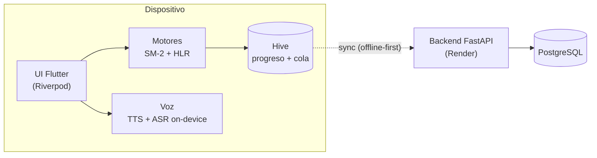
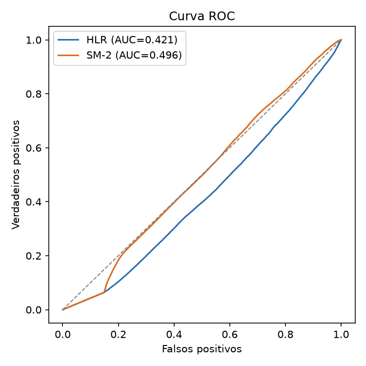
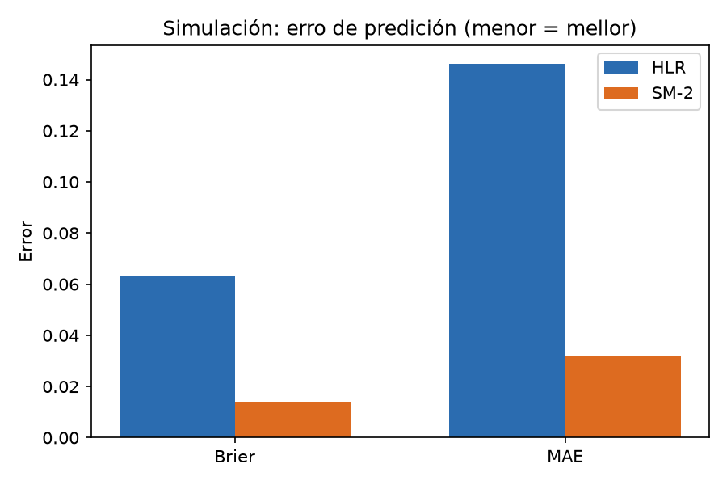
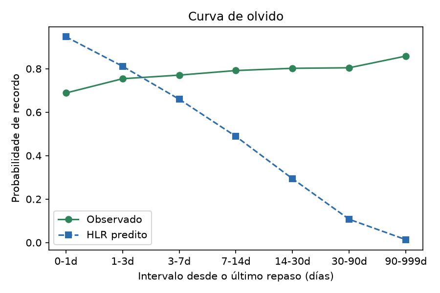

<div align="center">


# Galingo

### Aprende galego, paso a paso

App **multiplataforma** y ***offline-first*** para aprender gallego (nivel **A1**),
con motor de **repetición espaciada** y **voz en gallego 100 % en el dispositivo**.

[](https://github.com/Retselfernandez/Galingo/actions/workflows/build_beta.yml)
[](https://github.com/Retselfernandez/Galingo/releases/tag/beta)
[](https://flutter.dev)
[](#-plataformas)
[](#-internacionalización)
[](#-calidad)
[](LICENSE)


</div>

---

## 📖 ¿Qué es Galingo?

Galingo es una aplicación de **microaprendizaje gamificado** para aprender gallego
desde cero. Combina tres ideas:

- **Un camino guiado** («O Camiño do Galego»): 12 unidades y 70 lecciones que se
  desbloquean de forma secuencial.
- **Repetición espaciada**: cada acierto y error alimenta un motor de memoria que
  decide **cuándo** repasar cada palabra (SM-2 como línea base + un modelo **HLR**
  de regresión logística).
- **Voz en gallego, sin conexión**: audio neuronal (Proxecto Nós) y evaluación de
  pronunciación con un modelo **Whisper** ejecutado **en el propio dispositivo**.

> 🎯 **Alcance actual:** nivel **A1**. Los niveles A2/B1/B2 están desactivados en la
> interfaz (sus JSON se conservan); se reactivan añadiendo el nivel a
> `AppConstants.enabledLevels`.

<div align="center">

<br/>
<sub><i>Gabi, la gaviota que te acompaña durante el camino.</i></sub>
</div>

---

## ✨ Características

| | Característica | Detalle |
|---|---|---|
| 🗺️ | **Camino gamificado** | 12 unidades · 70 lecciones · progreso y desbloqueo secuencial |
| 🧩 | **9 tipos de ejercicio** | opción múltiple, huecos, emparejar, traducción, ordenar, lectura, imagen, dictado y voz |
| 🔊 | **Audio del modelo** | 119 audios con voz neuronal gallega (*Celtia*, Proxecto Nós) |
| 🎙️ | **Pronunciación evaluada** | reconocimiento **on-device** + similitud fonética por palabra |
| 🔁 | **Motor de repaso** | botón **«Repaso (N)»** cuando hay ítems vencidos; lección generada dinámicamente |
| ❤️ | **Vidas y racha** | 5 corazones, XP, racha diaria y pantalla de fin de lección |
| 🌍 | **8 idiomas de interfaz** | es · en · pt · fr · it · de · ro · zh (los enunciados se localizan manteniendo el gallego) |
| 📶 | **Offline-first** | Hive local; la telemetría se encola y se sincroniza al recuperar red |
| 📝 | **Reporte de incidencias** | agitando el móvil o desde Ajustes |
| 🌗 | **Tema claro/oscuro** | y tamaño de texto ajustable |

<!-- 📸 CAPTURAS: engádense aquí cando estean en .github/assets/ -->

---

## 🚀 Empezar

### Requisitos

- **Flutter ≥ 3.19** (Dart ≥ 3.3)
- Para iOS/macOS: Xcode. Para Android: JDK 17.

```bash
flutter pub get
flutter run
```

### Tests y análisis

```bash
flutter test        # 41 tests
flutter analyze     # sin incidencias
```

### Compilar la beta (con backend y voz)

```bash
# 1) Descarga el modelo de voz on-device (~370 MB, no versionado)
bash tool/fetch_asr_model.sh small

# 2) Compila apuntando al backend
flutter build apk   --release --dart-define=API_BASE_URL=https://galingo-backend.onrender.com
flutter build ios   --release --dart-define=API_BASE_URL=https://galingo-backend.onrender.com
```

---

## 📱 Plataformas

| Plataforma | Estado | Notas |
|---|---|---|
| **Android** | ✅ Beta | APK firmado; **es la vía de distribución de la beta** |
| **iOS** | ✅ | *Sideload* con Apple ID personal (caduca cada 7 días) |
| **macOS** | ✅ | App de escritorio |
| **Windows** | ✅ | App de escritorio |
| **Web** | ✅ | Sin voz local (el navegador no expone el modelo) |

---

## 🏗️ Arquitectura

Cliente **Flutter** autónomo (aprendizaje y voz locales) y un **backend ligero** que
solo recibe telemetría y *feedback*. El cliente funciona aunque el backend no esté.



<details>
<summary><b>Ver estructura del proyecto</b></summary>

```
lib/
├── core/            tema, router, i18n, motores (SM-2/HLR), servicios (voz, telemetría)
├── data/            modelos, repositorios (Hive), carga de contenido
└── presentation/    pantallas, providers (Riverpod) y widgets

assets/
├── content/         curso A1 en JSON (12 unidades / 70 lecciones / 573 ejercicios)
├── audio/exercises/ 119 audios TTS (voz gallega)
├── images/          arte de la app (icono, mascota, ejercicios)
└── models/whisper/  modelo ASR (no versionado; se descarga con tool/fetch_asr_model.sh)

backend/             FastAPI: telemetría, feedback y export para análisis
tool/                scripts (modelo de voz, i18n de ejercicios)
```

</details>

---

## 🎙️ Voz en gallego (todo en el dispositivo)

El gallego no tiene soporte nativo de voz en Android ni iOS, así que Galingo lo
resuelve **localmente**, sin enviar audio a ningún servidor:

- **TTS (audio del modelo):** voz neuronal ***Celtia*** del **Proxecto Nós** (USC)
  en ONNX, vía `phoonnx`. Salida en `assets/audio/exercises/{id}.mp3`.
- **ASR (evaluación de pronunciación y dictado):** **Whisper** (variante *small*
  int8) ejecutado con **sherpa-onnx**, **sin conexión**. El modelo se intercambia
  por tamaño con `bash tool/fetch_asr_model.sh [tiny|base|small|medium]`.
- **Comparación fonética:** normalización de texto gallego y similitud por palabra
  (umbral configurable en `AppConstants.speechPassThreshold`).

> 🔒 **Privacidad:** el audio **nunca sale del dispositivo**.

---

## 🧠 Repetición espaciada (SM-2 + HLR)

- **SM-2** (línea base determinista): calcula el intervalo y `nextDue` de cada ítem.
- **HLR** (Half-Life Regression): modelo de regresión logística entrenado con la
  telemetría real, que estima la probabilidad de recuerdo y la vida media.
- **Cola de repaso:** cuando un ítem vence, aparece **«Repaso (N)»** en el HOME y se
  genera una lección de repaso dinámica.

---

## 🌍 Internacionalización

La interfaz está en **8 idiomas** (`lib/l10n/*.arb`): **es · en · pt · fr · it · de ·
ro · zh**. Los **enunciados de los ejercicios** también se localizan, protegiendo el
contenido en gallego y los nombres propios (generado con `tool/i18n_exercises.py`).

---

## ☁️ Backend y telemetría

El backend es **FastAPI + PostgreSQL**, desplegado **gratis en Render** (Docker), y
solo se ocupa de la telemetría y el *feedback* (el ASR ya no corre en el servidor):

| Endpoint | Uso |
|---|---|
| `POST /api/v1/interaccion` | eventos de repaso (ítem, resultado, intervalo, dificultad) |
| `POST /api/v1/sesion` | sesiones diarias (retención D1/D7) |
| `POST /api/v1/feedback` | reportes de incidencia |
| `GET /api/v1/metricas` | métricas agregadas |
| `GET /api/v1/export` | export protegido con `EXPORT_TOKEN` (para el análisis) |

```bash
# Backend en local
cd backend
pip install -r requirements.txt
DATABASE_URL="sqlite:///./galingo.db" uvicorn main:app --port 8000
```

La app es **offline-first**: si no hay red, los eventos se guardan en Hive y se
suben por lotes al recuperar conexión.

---

## 📦 Beta

La beta se **compila y publica automáticamente** en cada *push* a `main`
(GitHub Actions):

**⬇️ https://github.com/Retselfernandez/Galingo/releases/tag/beta**

| Artefacto | Contenido |
|---|---|
| `Galingo-Beta-Android.apk` | APK con **voz offline** y apuntando al backend |
| `Galingo-Windows-Beta.zip` | App de escritorio (Windows) |
| `Galingo-macOS-Beta.zip` | App de escritorio (macOS) |

El *pipeline* ejecuta `flutter analyze` + `flutter test`, descarga el modelo de voz,
compila las tres plataformas y publica la release. El enlace es **estable** (siempre
el mismo tag `beta`).

---

## 📊 Evaluación

El sistema se evaluó con **datos reales** de repetición espaciada y una **simulación
con verdad conocida**, y con la telemetría de la beta:

| | |
|---|---|
| **Error del modelo (datos reales, 3,17 M repasos)** | HLR MAE 0,488 · SM-2 MAE 0,563 (**−13,3 %**) |
| **Sesgo de programación adaptativa** | documentado (los datos proceden de otro programador → confusor) |
| **Voz on-device** | 94 % de acierto con el modelo *small* (100 % con *medium*) |
| **Calidad** | 41 tests, `flutter analyze` limpio, CI en cada push |

<div align="center">


<br/>


</div>

---

## 🧰 Stack

| Capa | Tecnología |
|---|---|
| Cliente | **Flutter / Dart** (un código → 5 plataformas) |
| Estado | **Riverpod** |
| Persistencia local | **Hive** (offline-first) |
| Backend | **FastAPI** (Python) + **PostgreSQL**, desplegado en **Render** |
| ML | **scikit-learn** / NumPy (HLR), experimentos reproducibles |
| Voz (TTS) | **Proxecto Nós** — voz *Celtia* (VITS ONNX, `phoonnx`) |
| Voz (ASR) | **sherpa-onnx + Whisper** (int8, on-device) |
| Audio | `audioplayers`, `record` |
| Iconos | `flutter_launcher_icons` (gaviota en todas las plataformas) |
| CI/CD | **GitHub Actions** (analyze + tests + builds + release) |

---

## ✅ Calidad

- **41 tests** (`flutter test`) y `flutter analyze` sin incidencias.
- **CI** en cada *push*: *gate* de calidad antes de compilar y publicar.
- Los defectos detectados por los testers se convierten en **tests de regresión**.

---

## 🗺️ Hoja de ruta

- [x] Curso A1 completo (573 ejercicios)
- [x] Voz on-device (TTS + ASR) sin conexión
- [x] Motor de repaso (SM-2 + HLR) y cola de ítems vencidos
- [x] 8 idiomas de interfaz
- [x] Beta automatizada (APK firmado + release)
- [ ] Más ejercicios de dictado
- [ ] Reactivar niveles A2/B1/B2
- [ ] Publicación en tiendas (requiere cuentas de desarrollador)

---

## 🙏 Créditos y licencia

- Voz y modelos del **Proxecto Nós** — Universidade de Santiago de Compostela.
- **Whisper** (OpenAI) y **sherpa-onnx** como base del reconocimiento on-device.
- **Flutter** y el ecosistema de `pub.dev`.

Distribuido bajo licencia **Creative Commons BY-NC 4.0** (uso no comercial) —
ver [`LICENSE`](LICENSE). Los recursos de terceros mantienen sus propias licencias.

<div align="center">
<sub>Hecho con ❤️ para la normalización del <b>galego</b>.</sub>
</div>
