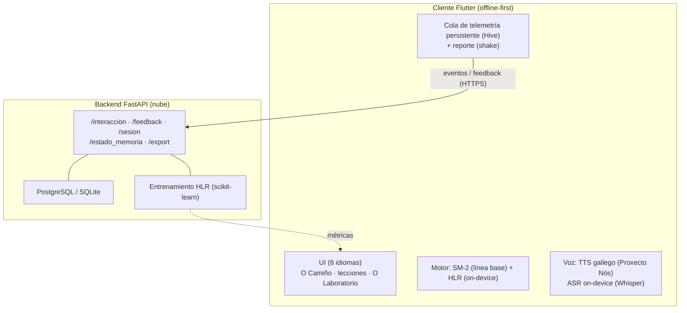
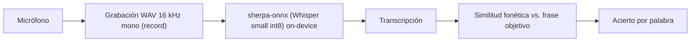
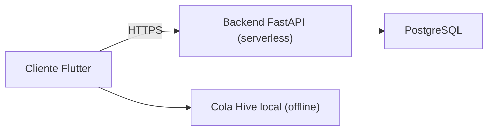
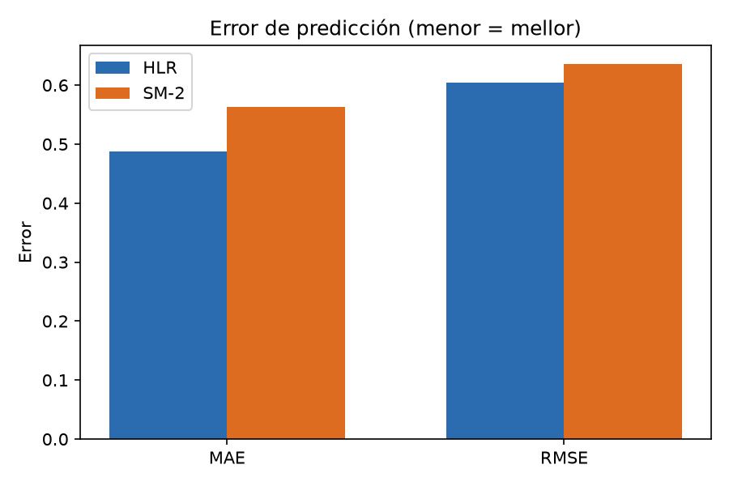
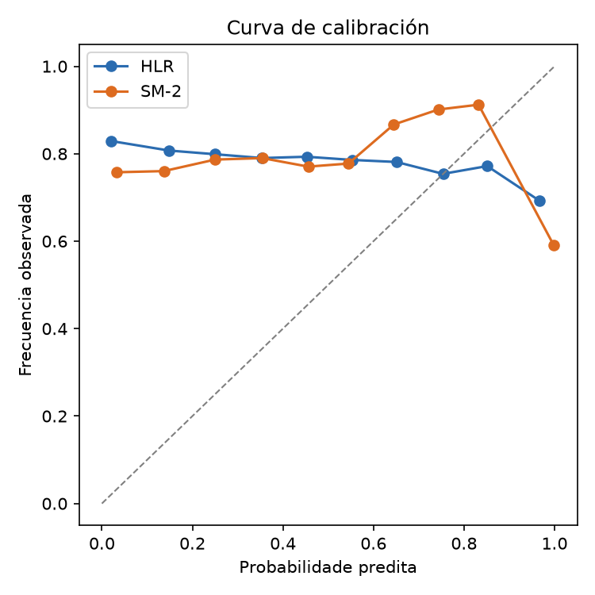
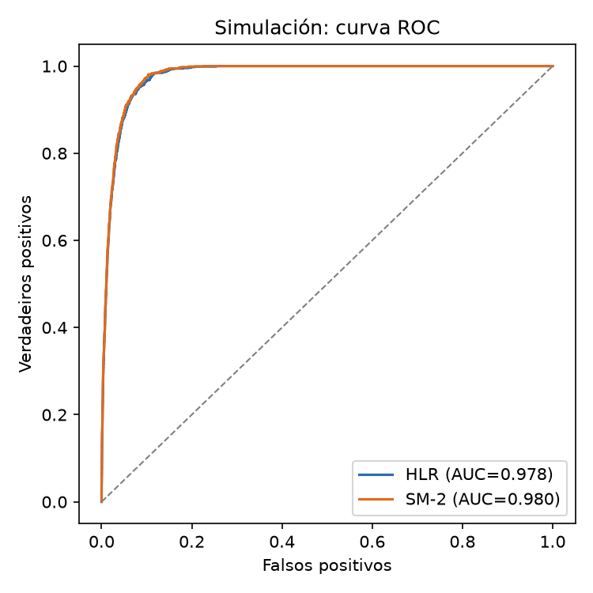
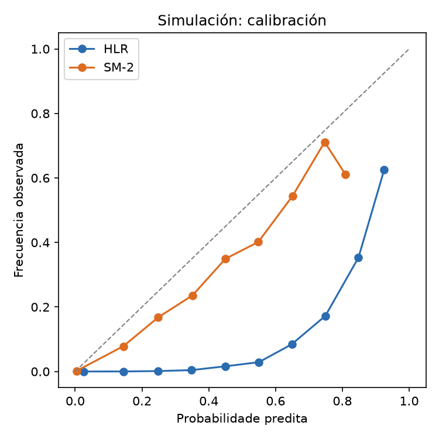

**Universidade de Vigo** · **Escola Superior de Enxeñaría Informática**

Memoria del Trabajo de Fin de Máster que presenta **Lester Andre Fernández Cedeño**
para la obtención del Título de **Máster en Enxeñaría Informática**

## Diseño, implementación y validación de una plataforma gamificada basada en modelos probabilísticos de repetición espaciada para el aprendizaje del idioma gallego (Galingo)

Curso 2025/2026

Trabajo de Fin de Máster Nº: ______

Tutor/a: Francisco Javier Rodríguez · Área de coñecemento: ______ · Departamento: ______

*Versión 4.1*

---

## Resumen

Este Trabajo de Fin de Máster aborda el diseño, la implementación y la validación de **Galingo**, una plataforma multiplataforma (Android, iOS, macOS, Windows y Web) para la adquisición del gallego en el nivel A1 del Marco Común Europeo de Referencia, dirigida a personas no gallegoparlantes. El problema que se aborda es doble: (i) la exclusión sistemática de las lenguas minorizadas de los ecosistemas comerciales de *microlearning*, que constituye una barrera tecnológica para la integración lingüística de la población migrante en Galicia, y (ii) la falta de herramientas de voz en gallego que funcionen sin conexión.

Se ha construido un sistema completo que integra: un cliente Flutter *offline-first*; un backend desacoplado en FastAPI desplegado en la nube; un motor de retención de memoria que combina la heurística determinista **SM-2** (línea base) con un modelo probabilístico de **Regresión de Vida Media (HLR)**, tanto en el dispositivo como en servidor; y una **capa de voz íntegramente local**, con síntesis de voz (Proxecto Nós) para los ejercicios de escucha y reconocimiento automático del habla *on-device* (sherpa-onnx + Whisper) para la evaluación de la pronunciación. La interfaz y los enunciados están internacionalizados a **ocho idiomas**, manteniendo el gallego como lengua objetivo. La plataforma se ha validado mediante una beta cerrada con telemetría anónima, reporte de incidencias integrado y análisis de retención (D1/D7) y del error del modelo.

**Palabras clave:** microlearning, repetición espaciada, aprendizaje automático, regresión de vida media, procesamiento del lenguaje natural, arquitectura de software, lenguas minorizadas, reconocimiento automático del habla, integración sociocultural.

## Abstract

This Master's Thesis presents the design, implementation and validation of **Galingo**, a cross-platform application (Android, iOS, macOS, Windows and Web) for learning Galician at the A1 level of the Common European Framework of Reference, aimed at non-Galician speakers. The problem addressed is twofold: (i) the systematic exclusion of minority languages from commercial microlearning ecosystems, which creates a technological barrier to the linguistic integration of migrant populations in Galicia, and (ii) the lack of Galician voice tools that work offline.

A complete system has been built that integrates: an *offline-first* Flutter client; a decoupled FastAPI backend deployed in the cloud; a memory-retention engine combining the deterministic **SM-2** heuristic (baseline) with a probabilistic **Half-Life Regression (HLR)** model, both on-device and server-side; and a **fully local voice layer**, with text-to-speech (Proxecto Nós) for listening exercises and *on-device* automatic speech recognition (sherpa-onnx + Whisper) for pronunciation assessment. The interface and the exercise statements are internationalised into **eight languages**, keeping Galician as the target language. The platform has been validated through a closed beta with anonymous telemetry, integrated issue reporting, and retention (D1/D7) and model-error analysis.

**Keywords:** microlearning, spaced repetition, machine learning, half-life regression, natural language processing, software architecture, minority languages, automatic speech recognition, sociocultural integration.

## Índice de contenidos

1. Introducción · 2. Fundamentos y estado del arte · 3. Objetivos, alcance e hipótesis · 4. Planificación y seguimiento · 5. Metodología y solución propuesta · 6. Arquitectura y diseño de software · 7. Tecnologías, datos y reproducibilidad · 8. Especificación y análisis de requisitos · 9. Evaluación experimental · 10. Verificación y calidad del software · 11. Manual de instalación y uso · 12. Discusión · 13. Conclusiones y trabajo futuro · Referencias · Anexos

## Índice de ilustraciones / Índice de tablas

*(Se generarán automáticamente en el documento final.)*

---

# 1. Introducción

## 1.1 Contexto y motivación

La combinación de ingeniería de software, gamificación y aprendizaje automático ha transformado la manera de aprender una segunda lengua durante la última década. Las plataformas globales de microaprendizaje retienen a las personas usuarias mediante bucles de retroalimentación inmediata, sesiones breves y mecánicas de juego, pero reservan el desarrollo algorítmico avanzado para las lenguas con mayor tamaño de mercado. Las lenguas minorizadas quedan cubiertas por recursos digitales estáticos, fragmentados y sin metodologías de retención adaptativa.

En el caso del gallego, esta desigualdad tecnológica tiene consecuencias sociales concretas. Galicia recibe población migrante de forma continuada, y la lengua propia es un factor central para el **arraigo territorial**, la **inserción laboral** y la **cohesión familiar**. La falta de herramientas accesibles para la inmersión lingüística —sobre todo en los niveles iniciales A1/A2— dificulta el aprendizaje progresivo de personas adultas y de menores en edad escolar. El gallego, además, comparte con otras lenguas minorizadas un ecosistema digital limitado: recursos institucionales valiosos pero a menudo desconectados entre sí, y una presencia escasa en las aplicaciones comerciales de aprendizaje.

A esta brecha de contenido se suma una **brecha tecnológica específica**: ni Android ni iOS ofrecen **reconocimiento del habla en gallego** de forma nativa. Cualquier aplicación que quiera evaluar la pronunciación —la destreza oral, tradicionalmente la más difícil de practicar sin un docente— se ve forzada a depender de servicios en la nube, lo que exige conexión permanente, introduce latencia y compromete la privacidad del audio. Esta limitación es especialmente relevante para una app de idiomas, donde la voz es un componente esencial.

Galingo nace de aplicar ingeniería de producto e inteligencia artificial a este doble problema: **facilitar el acceso al gallego** con una experiencia interactiva y gamificada, y **resolver la voz en el propio dispositivo**, de forma privada y sin conexión. El proyecto se plantea, por tanto, no solo como una interfaz de usuario, sino como una **infraestructura de software** que combine un modelo probabilístico de memoria, una arquitectura desacoplada y una capa de voz local, con un coste de operación nulo que lo haga sostenible sin presupuesto.

## 1.2 Formulación del problema

El problema técnico abordado es la **ineficiencia de los métodos de repaso estático** en las herramientas existentes para el gallego. La ciencia cognitiva describe la retención de la información mediante la curva de olvido de Ebbinghaus, según la cual la probabilidad de recuerdo $p$ tras un tiempo $t$ decae de forma aproximadamente exponencial en función de la fuerza de memoria o vida media $h$:

$$p = 2^{-\frac{t}{h}}$$

Los sistemas de *flashcards* disponibles para lenguas minorizadas tratan $h$ como una variable determinista que se incrementa mediante multiplicadores fijos tras cada acierto (algoritmo **SM-2**), sin aprovechar la latencia de respuesta, el historial real de aciertos y fallos, ni la dificultad intrínseca —léxica y sintáctica— del ítem evaluado. El reto consiste en construir una infraestructura que **capture eventos de interacción de forma continua** y los use para **entrenar un modelo que estime $h$** minimizando el error frente a los resultados reales, dentro de una aplicación multiplataforma capaz de responder con la rapidez suficiente para no interrumpir la sesión de estudio.

La formulación del problema se concreta en tres subproblemas:

1. **Captura y gestión del dato.** Registrar de forma fiable los eventos de repaso (resultado, intervalo, latencia) incluso sin conexión, y almacenarlos de forma que sean útiles para el entrenamiento.
2. **Modelado de la memoria.** Estimar $h$ a partir de características del ítem y del usuario, y **decidir cuándo repasar** cada ítem.
3. **Voz local.** Ofrecer síntesis y reconocimiento del habla en gallego **sin conexión** y sin enviar el audio a terceros.

A este reto algorítmico se añade un reto **metodológico**: la evaluación de un modelo de memoria sobre datos reales es sutil, porque los planificadores óptimos programan los repasos de forma adaptativa y confunden la relación entre tiempo y recuerdo (§9). Abordar ese sesgo de forma explícita forma parte del problema de investigación.

## 1.3 Contribuciones

Las contribuciones principales de este trabajo son:

1. **Un sistema completo y desplegado** de microaprendizaje del gallego (A1), multiplataforma, con cliente Flutter *offline-first* y backend desacoplado.
2. **Doble motor de repetición espaciada** (SM-2 como línea base y HLR como modelo entrenable) implementado tanto en el dispositivo como en servidor, con métrica de error visible para la persona usuaria.
3. **Capa de voz gallega 100 % local**: síntesis neuronal (Proxecto Nós) y reconocimiento *on-device* (sherpa-onnx + Whisper), sin conexión y sin envío de audio.
4. **Internacionalización con lengua objetivo**: interfaz y enunciados en ocho idiomas, con 573 ejercicios y el gallego como contenido.
5. **Ciclo de mejora basado en datos**: telemetría anónima y reporte de incidencias integrado, que han permitido detectar y corregir defectos reales durante la beta.
6. **Un análisis metodológico del sesgo de programación adaptativa** en la evaluación de modelos de recuerdo, de aplicación general a este tipo de sistemas.

## 1.4 Organización de la memoria

El documento se estructura así: el capítulo 2 revisa los fundamentos y el estado del arte; el 3 fija objetivos, alcance e hipótesis; el 4 describe la planificación y su seguimiento; el 5 la metodología y la solución propuesta; el 6 la arquitectura y el diseño del software; el 7 las tecnologías, los datos y la reproducibilidad; el 8 la especificación de requisitos; el 9 la evaluación experimental; el 10 la verificación y calidad del software; el 11 el manual de instalación y uso; el 12 discute resultados, limitaciones y amenazas a la validez; y el 13 recoge las conclusiones y las vías de trabajo futuro.

---

# 2. Fundamentos y estado del arte

## 2.1 Microaprendizaje y gamificación

El **microaprendizaje** consiste en segmentar el contenido en unidades breves y autocontenidas que se consumen en sesiones cortas y frecuentes. Su eficacia se apoya en principios de la psicología cognitiva ampliamente contrastados: la **práctica distribuida** (el aprendizaje se consolida mejor cuando se reparte en el tiempo que cuando se concentra en una sola sesión), la **práctica de recuperación** (*retrieval practice*, recordar activamente refuerza la memoria más que releer) y el **efecto de prueba** (los tests no solo miden, sino que consolidan). A ello se suma la **carga cognitiva**: presentar un solo concepto por unidad minimiza la carga extrínseca y libera recursos para la carga relevante (la construcción de esquemas).

Las plataformas comerciales de mayor difusión han industrializado este patrón y lo han combinado con **gamificación**: rachas de días consecutivos, puntos de experiencia (XP), niveles, vidas y desbloqueo progresivo. Estas mecánicas actúan sobre la motivación extrínseca y sobre la formación de hábito, y explican en gran medida su retención de usuarios. Sin embargo, su desarrollo algorítmico se concentra en las lenguas con mayor tamaño de mercado, y las minorizadas quedan fuera del ecosistema: los recursos disponibles son estáticos (diccionarios, listas de vocabulario) y carecen de **repetición adaptativa** y de **retroalimentación interactiva**.

Galingo adopta estas mecánicas de producto —microaprendizaje, racha, XP, niveles, desbloqueo— pero las aplica a una lengua minorizada, con especial atención a la **reducción de la fricción cognitiva inicial**: sesiones cortas, un tipo de ejercicio claro por pantalla, y una estética que no exige conocimientos previos de la lengua objetivo.

## 2.2 Repetición espaciada: de la heurística al modelo aprendido

La **curva de olvido** de Ebbinghaus (1885) [1] describe el decaimiento de la retención a lo largo del tiempo y constituye el fundamento de todos los sistemas de repetición espaciada. Sobre ella se han construido varias generaciones de algoritmos:

- **Leitner (1972)** [2]. Sistema de cajas: cada acierto promueve la tarjeta a una caja con intervalos mayores; cada fallo la devuelve a la primera. Sencillo y determinista.
- **SuperMemo / SM-2 (Wozniak, 1987–1990).** Introdujo el **factor de facilidad** $EF$ y la calidad de respuesta $q\in[0,5]$, ajustando el intervalo de forma multiplicativa. Sigue siendo el estándar de facto en aplicaciones de *flashcards* [3]. Es sensible al historial, pero sus parámetros están **fijados a mano** y no se aprenden de los datos.
- **Anki / FSRS.** Popularizaron SM-2 en la práctica y, más recientemente, el *Free Spaced Repetition Scheduler* (FSRS) [4], un modelo basado en la dificultad y la estabilidad de cada tarjeta, estimado por optimización a partir de los *logs* del propio usuario.
- **HLR (Settles y Meeder, 2016).** Da un paso más: en lugar de un intervalo heurístico, **estima la vida media** $h$ mediante una regresión sobre características del ítem y del usuario, y deriva de ella la probabilidad de recuerdo [5].

- **Modelos de *Deep Knowledge Tracing* (DKT).** Sustituyen la regresión por redes recurrentes capaces de modelar secuencias completas de interacción [6], a costa de más datos y complejidad.

| Modelo | Parámetros | ¿Aprende de datos? | Entrada | Complejidad |
|---|---|---|---|---|
| Leitner | Fijos | No | Resultado | Muy baja |
| SM-2 | Fijos ($EF$) | No | Resultado | Baja |
| FSRS | Estimados | Sí (por usuario) | Historial de la tarjeta | Media |
| **HLR** | Entrenados | Sí | Features del ítem/usuario | Media |
| DKT | Red neuronal | Sí | Secuencia completa | Alta |

Galingo implementa **SM-2** como línea base determinista (por su simplicidad, reproducibilidad y popularidad) y **HLR** como modelo entrenable, y los ejecuta **en paralelo** sobre los mismos eventos para compararlos de forma directa.

## 2.3 Aprendizaje automático aplicado a la memoria del usuario

La predicción del recuerdo es un problema de **clasificación probabilística binaria**: se estima la probabilidad $\hat{p}$ de que un repaso sea recordado ($p\in\{0,1\}$). La elección de la métrica es crítica:

- **MAE / RMSE.** Error absoluto/cuadrático medio. Intuitivos, pero sobre salidas binarias están **dominados por la tasa base**: si el 90 % de los repasos se recuerdan, predecir siempre $\hat{p}=0{,}9$ da un MAE bajo sin discriminar nada.
- ***Brier score*.** Error cuadrático de la probabilidad; adecuado para pronósticos probabilísticos, pero con la misma limitación de tasa base.
- **AUC-ROC.** Mide la **capacidad de discriminación** (ordenar correctamente los aciertos por encima de los fallos) y es **independiente de la tasa base**; es la métrica más informativa para comparar modelos de recuerdo.
- **Calibración.** Relaciona la probabilidad predicha con la frecuencia observada (diagrama de fiabilidad). Un modelo bien calibrado es útil para **decidir cuándo repasar**.

Un aspecto metodológico central, y a menudo ignorado, es la **naturaleza adaptativa de la programación de repasos**. Los planificadores óptimos (FSRS, Anki) asignan **intervalos largos a los ítems bien conocidos** y cortos a los difíciles, de modo que la probabilidad de recuerdo observada se mantiene aproximadamente constante **con independencia del tiempo transcurrido**. Como consecuencia, el tiempo $t$ **deja de discriminar** y cualquier modelo basado en él se vuelve difícil de evaluar de forma ingenua. Este trabajo **caracteriza explícitamente ese sesgo** (§9) y propone contrastarlo con una **simulación de intervalos aleatorios** con verdad conocida, en la que el efecto de la programación adaptativa desaparece.

## 2.4 Reconocimiento y síntesis de voz para lenguas minorizadas

La **voz** es un componente esencial de una app de idiomas (escuchar y pronunciar), pero también el más difícil de resolver para una lengua minorizada, por la escasez de recursos y la ausencia de soporte nativo en los sistemas operativos.

**Reconocimiento automático del habla (ASR).** Los sistemas operativos ofrecen ASR nativo (*SFSpeechRecognizer* en iOS, *SpeechRecognizer* en Android), pero **ninguno incluye el gallego**; al forzar un idioma cercano (p. ej. español) la transcripción degrada y produce falsos negativos en la evaluación de la pronunciación. Las alternativas basadas en modelos:

- **Whisper** [7] es un modelo *encoder-decoder* multilingüe entrenado con grandes volúmenes de audio débilmente supervisado; reconoce gallego razonablemente bien. Sus variantes *tiny/base/small/medium/large* ofrecen un compromiso tamaño/precisión; la *small* cuantizada a int8 (~370 MB) es viable en móvil.
- **wav2vec 2.0 / conformer** [8] afinados para gallego (p. ej. recursos del Proxecto Nós [9]) alcanzan mejor precisión, pero exigen arquitecturas que no siempre están soportadas por los *runtimes* móviles y exportaciones complejas.
- **Ejecución *on-device*.** **sherpa-onnx** [10] permite ejecutar modelos ONNX (incluido Whisper) en el dispositivo, sin conexión. Combinado con Whisper, resuelve el ASR en gallego **sin depender de servicios en la nube**, preservando la privacidad.

**Síntesis de voz (TTS).** Las voces neuronales han superado a las concatenativas en naturalidad. El **Proxecto Nós** [9] publica voces en gallego (entre ellas *Celtia*, basada en VITS [11]) que permiten generar el **audio del modelo** para los ejercicios de escucha y de pronunciación con una prosodia gallega auténtica, evitando el efecto "portugués" de voces de idiomas vecinos.

**Recursos del ILG.** El Instituto da Lingua Galega ofrece **CORILGA** (corpus oral) [12] y recursos de generación automática de lenguaje [13], relevantes para futuros dictados con voz natural y para modelar la dificultad léxica real de los ítems.

## 2.5 Internacionalización y aprendizaje de segundas lenguas

El **Marco Común Europeo de Referencia (MCER)** [14] organiza la competencia en seis niveles (A1–C2); Galingo se centra en el **A1** (usuario básico), que corresponde a presentaciones, saludos, números, familia, rutinas diarias y vocabulario cotidiano.

Desde la **adquisición de segundas lenguas (SLA)**, el diseño se apoya en la **hipótesis del *input* comprensible** (se aprende mejor con material ligeramente por encima del nivel actual), la **hipótesis de la producción** (producir la lengua —incluida la pronunciación— consolida el aprendizaje) y la **enseñanza explícita de vocabulario** con repetición espaciada. La evaluación de la pronunciación mediante ASR materializa la producción oral, tradicionalmente la destreza más difícil de evaluar sin un docente.

Un requisito clave para un público **no gallegoparlante** es **separar el contenido de la lengua objetivo (gallego) del andamiaje** (enunciados, instrucciones e interfaz), que deben ofrecerse en el **idioma del usuario**. La cercanía entre gallego y portugués, aprovechada en traducción automática [15], informa además la **normalización fonética** del texto reconocido (§5.5), que tolera variantes ortográficas entre ambas lenguas.

## 2.6 Posicionamiento de Galingo

Galingo se sitúa en la intersección de tres brechas identificadas en la literatura y en el mercado:

1. **Brecha de contenido:** las lenguas minorizadas no tienen microaprendizaje adaptativo.
2. **Brecha algorítmica:** los modelos entrenables de memoria (HLR, FSRS, DKT) apenas se han aplicado a lenguas minorizadas.
3. **Brecha de voz:** no existe ASR nativo ni, en general, soluciones de voz **locales** para el gallego.

Frente a ellas, Galingo aporta un sistema que traslada un modelo probabilístico de memoria a una lengua minorizada, resuelve la voz de forma **local y privada**, e internacionaliza el andamiaje manteniendo la lengua objetivo. Sus aportaciones se contrastan con una línea base determinista (SM-2) y se discuten **abiertamente sus limitaciones** y las amenazas a la validez (§12), lo que lo distingue de las evaluaciones puramente optimistas.

# 3. Objetivos, alcance e hipótesis

## 3.1 Objetivo general

Diseñar, implementar y validar una plataforma multiplataforma, **Galingo**, estructurada bajo el paradigma del microaprendizaje, que integre un algoritmo probabilístico de Regresión de Vida Media entrenado con datos de interacción para optimizar la curva de asimilación del gallego en personas no gallegoparlantes, comparando su rendimiento frente a la heurística clásica SM-2, y que resuelva íntegramente la capa de voz (síntesis y reconocimiento) en el propio dispositivo.

## 3.2 Objetivos específicos

- **O1. Algorítmicos.**
  - O1.1 Diseñar una base de datos relacional (ítems léxicos, estado de memoria, trazas de interacción).
  - O1.2 Implementar un proceso de **ingesta continua** de telemetría, idempotente y tolerante a desconexiones.
  - O1.3 Implementar la línea base determinista **SM-2** (factor de facilidad, intervalo, reinicio por fallo).
  - O1.4 Implementar el modelo entrenable **HLR** (estimación de vida media por características).
  - O1.5 Evaluar ambos con métricas apropiadas para recuerdo binario (MAE, *Brier*, AUC-ROC, calibración) y partición por usuario.

- **O2. Arquitectónicos.**
  - O2.1 Construir una **API desacoplada** del cliente con procesamiento en segundo plano.
  - O2.2 Diseñar una **cola *offline*** persistente que evite la pérdida de telemetría.
  - O2.3 Desplegar el backend en una plataforma de coste nulo con *warm-up* para evitar la latencia en frío.

- **O3. De producto.**
  - O3.1 Implementar un sistema de componentes reutilizable que reduzca la fricción inicial.
  - O3.2 Integrar mecánicas de gamificación (racha, XP, niveles, desbloqueo).
  - O3.3 Integrar el aprendizaje guiado (**O Camiño**) y la consulta léxico-verbal (**O Laboratorio**).
  - O3.4 Implementar un **motor de repasos** que reexponga los ítems vencidos en días sucesivos.

- **O4. De voz.**
  - O4.1 Generar el **audio del modelo** con una voz neuronal gallega.
  - O4.2 Ejecutar el **reconocimiento del habla *on-device*** (sin conexión).
  - O4.3 Evaluar la pronunciación con acierto por palabra y umbral calibrado, con una métrica tolerante a variantes gallego/portugués.

- **O5. De internacionalización.**
  - O5.1 Localizar la interfaz en ocho idiomas.
  - O5.2 Localizar los **enunciados** de los ejercicios **manteniendo el gallego** como contenido.

- **O6. De validación.**
  - O6.1 Desplegar una beta cerrada instrumentada.
  - O6.2 Analizar retención (D1/D7), uso y error del modelo.
  - O6.3 Discutir honestamente limitaciones y amenazas a la validez.

## 3.3 Hipótesis

- **H1 (eficiencia predictiva).** Un modelo entrenable basado en HLR obtendrá un **menor error** y una **curva de calibración más ajustada** que SM-2 en la predicción del recuerdo.
- **H2 (retención de producto).** La combinación de microaprendizaje gamificado con repetición espaciada y voz local producirá una **retención en el día 7** superior a la de los recursos estáticos, con menor fricción inicial.

## 3.4 Alcance y limitaciones

- **Nivel A1.** Corpus de **12 unidades, 70 lecciones y 573 ejercicios** (apartados de Vocabulario, Gramática, Escucha, Ortografía, Lectura y Pronuncia). Los niveles A2/B1/B2 quedan desactivados (contenido conservado y reactivable por configuración).
- **Motor verbal.** Consulta de conjugación de verbos regulares en presente, pretérito y futuro de indicativo.
- **Voz.** Síntesis con voz neuronal gallega (Proxecto Nós) y ASR con Whisper *small* multilingüe cuantizado a int8, ejecutado *on-device*; la precisión es buena pero inferior a la de un modelo afinado específicamente, lo que se compensa con una normalización fonética (§5).
- **Distribución.** Beta distribuida como APK firmado (GitHub Releases) y compilaciones locales; sin publicación en tiendas por el coste de las cuentas de desarrollador.

---

# 4. Planificación y seguimiento

## 4.1 Estrategia de trabajo

El desarrollo siguió un enfoque **iterativo e incremental (sprints)**, con un **gate de calidad automático** (análisis estático + batería de pruebas) previo a cada compilación y una fase final de **beta cerrada instrumentada**. Se mantuvo un documento de seguimiento (*As Built*) que registra, para cada fase, decisiones y artefactos, lo que permite reconstruir la evolución del proyecto.

**Sprints principales.**

| Sprint | Contenido | Entregable |
|---|---|---|
| S1 — Cimientos | Arquitectura Flutter, modelo de contenido (unidades/lecciones/ejercicios), navegación. | App navegable con lecciones. |
| S2 — Motor de repetición | SM-2 y HLR (Dart), persistencia del historial, MAE. | Motor con métrica visible. |
| S3 — Contenido A1 | Banco de 540 preguntas (+ 33 de pronuncia = 573 ejercicios), 12 unidades, tipos de ejercicio. | Curso A1 completo. |
| S4 — Backend y datos | FastAPI, PostgreSQL/SQLite, telemetría, feedback, despliegue. | API + ingesta. |
| S5 — Internacionalización | 8 locales, localización del contenido, generación de traducciones. | UI y enunciados en 8 idiomas. |
| S6 — Voz local | TTS (Proxecto Nós), ASR on-device (sherpa-onnx + Whisper), normalización fonética. | Pronunciación offline. |
| S7 — Beta y calidad | Firma, distribución, CI, responsividad, motor de repasos. | Beta en funcionamiento. |

**Metodología de calidad.** Cada *push* ejecuta el *pipeline* de CI (`flutter analyze` + `flutter test`) antes de compilar. Las decisiones de diseño se documentan; los defectos detectados en la beta se convierten en *tests* de regresión.

## 4.2 Hitos y seguimiento

| Fase | Peso | Estado | Evidencia |
|---|---|---|---|
| 0 — Higiene del repositorio (README, `.gitignore`, CI con gate) | 10 % | Completada | `.github/workflows`, `README.md` |
| 1 — Internacionalización de la interfaz y del contenido | 20 % | Completada | 8 locales, curso traducido |
| 2 — Robustez del motor SM-2/HLR (casos límite, MAE) | 10 % | Completada | `test/*`, MAE en Ajustes |
| 3 — Backend FastAPI + BD + telemetría + feedback | 25 % | Completada | `backend/`, endpoints desplegados |
| 4 — Responsividad multiplataforma, firma y CI | 15 % | Completada | Android/iOS/macOS/Windows |
| 5 — Voz local (TTS + ASR on-device) | — | Completada (ampliación) | sherpa-onnx + Whisper, Proxecto Nós |
| 6 — Beta y métricas | 15 % | En curso | telemetría D1/D7, HLR |
| 7 — Memoria Ver 4.0 | 5 % | En curso | este documento |

El **cronograma real** se ajustó a lo previsto salvo la **voz local** (fase 5), que surgió como ampliación al comprobar que ni Android ni iOS ofrecen ASR en gallego. Esta decisión eliminó la dependencia de la nube y mejoró la privacidad, a costa de recalibrar el alcance (A1) para priorizar calidad sobre cantidad.

## 4.3 Gestión de riesgos

| Riesgo | Impacto | Mitigación |
|---|---|---|
| Coste de infraestructura | Alto | Backend *serverless* gratuito (Modal) + *warm-up* al abrir la app. |
| ASR en gallego inexistente en los SO | Alto | ASR *on-device* (sherpa-onnx + Whisper) y normalización fonética. |
| Tamaño del modelo de voz en móvil | Medio | Modelo *small* int8; modelo intercambiable por tamaño. |
| Muestra de beta pequeña | Alto | Beta abierta y continua; análisis como piloto; motor de repasos para generar repeticiones. |
| Sesgo de programación adaptativa | Alto | Análisis explícito (§9) y simulación con verdad conocida. |
| Cuentas de desarrollador de pago | Medio | Distribución gratuita (APK + sideload iOS). |

---

# 5. Metodología y solución propuesta

## 5.1 Visión general

La solución sustituye los intervalos heurísticos fijos por una **función probabilística de pesos entrenada**, orquestada en una arquitectura cliente-servidor, y traslada toda la **capa de voz al dispositivo**. El flujo de datos es:



## 5.2 SM-2 como línea base determinista

SM-2 mantiene, por ítem, tres variables de estado: el **factor de facilidad** $EF$ (inicialmente 2,5), el número de repeticiones consecutivas correctas y el **intervalo** vigente en días. Tras cada intento con calidad $q\in[0,5]$ (en la app: acierto→4, fallo→1):

$$EF' = \max\big(1{,}3,\; EF + 0{,}1 - (5-q)(0{,}08 + (5-q)\,0{,}02)\big)$$

El intervalo evoluciona de forma determinista mientras $q\ge3$: primer repaso a 1 día, segundo a 6 días, y a partir de ahí $intervalo \times EF$; ante un fallo se **reinicia** a 1 día y se resetea el contador de repeticiones. La predicción de recuerdo asociada usa la vida media aproximada igual al intervalo vigente: $\hat{p}_{SM2} = 2^{-t/intervalo}$. SM-2 es la línea base por su simplicidad, reproducibilidad y ubicuidad, pero sus parámetros **no se aprenden** y no usa la latencia de respuesta.

## 5.3 Modelo HLR

HLR estima directamente la vida media del ítem a partir de un vector de características. En Galingo, $\mathbf{x} = [1, \sqrt{1+s}, \sqrt{1+f}, d]$, donde $s$ y $f$ son los aciertos y fallos acumulados del ítem y $d$ su dificultad. Las transformaciones $\sqrt{1+s}$ y $\sqrt{1+f}$ capturan el **rendimiento marginal decreciente** (los primeros aciertos aumentan mucho la vida media; los siguientes, menos). Las estimaciones son:

$$\hat{h}_{\boldsymbol{\theta}}(\mathbf{x}) = 2^{\boldsymbol{\theta}\cdot\mathbf{x}}, \qquad \hat{p} = 2^{-t/\hat{h}}$$

El entrenamiento minimiza el error de predicción del recuerdo y de la vida media observada, con regularización L2 de peso $\lambda$:

$$\mathcal{L}(\boldsymbol{\theta}) = \sum_i \big(p_i - \hat{p}_{\boldsymbol{\theta}}(\mathbf{x}_i)\big)^2 + \alpha \sum_i \big(h_i - \hat{h}_{\boldsymbol{\theta}}(\mathbf{x}_i)\big)^2 + \lambda \lVert \boldsymbol{\theta}\rVert_2^2$$

donde $h_i$ se deriva del resultado observado con suavizado ($p\in\{0{,}95,0{,}05\}$) para evitar valores infinitos. El término $\alpha$ pondera el ajuste de la vida media (que da al modelo información **más rica** que el simple acierto/fallo). En el cliente, el descenso de gradiente se aplica de forma **incremental** sobre los eventos de la sesión, con *gradient clipping* y acotación de los pesos $\theta\in[-5,5]$ para estabilidad numérica; en servidor se reentrena con scikit-learn sobre toda la telemetría. Esta doble ejecución permite ofrecer predicciones **sin conexión** y, a la vez, mejorar el modelo con datos agregados.

## 5.4 Planificador de repasos

Un modelo de memoria solo es útil si **decide cuándo repasar**. Galingo implementa un planificador que, por cada ítem con historial, calcula el **próximo vencimiento** a partir del intervalo SM-2 almacenado y de la marca temporal del último repaso:

$$\text{nextDue} = \text{lastPracticed} + \text{intervalo}\,(\text{días})$$

Cuando `nextDue` es anterior al instante actual, el ítem está **vencido** y entra en la **cola de repaso**, ordenada por antigüedad (los más atrasados primero) y limitada a un número máximo por sesión. La lección de repaso se construye dinámicamente mapeando cada palabra vencida a un ejercicio del curso (por su respuesta correcta). Este planificador es clave para el sistema: **garantiza que los ítems se vuelvan a ver en días sucesivos**, generando la secuencia de repasos $(s,f,t,p)$ que necesitan HLR y SM-2 para evaluarse con datos reales. Sin él, cada ítem se vería una única vez y no habría curva de olvido que modelar.

## 5.5 Capa de voz local

- **Síntesis (TTS).** Voz neuronal gallega (*Celtia*, Proxecto Nós) pregenerada a audio para los ejercicios de escucha y de pronunciación; se reproduce automáticamente al aparecer el ejercicio y con un botón de repetición. En los ejercicios de escucha, la frase gallega se **oculta** en el enunciado para no revelar la respuesta.
- **Reconocimiento (ASR).** Whisper *small* int8 ejecutado con **sherpa-onnx** en el dispositivo. La grabación (WAV, 16 kHz, mono) se transcribe localmente y se compara con la frase objetivo mediante una **similitud fonética** que tolera las variantes gallego/portugués que produce el modelo (`nh↔ñ`, `camiñar↔caminhar`), los dígitos escritos como cifra (`7`→`sete`) y la segmentación de palabras. Se calcula un **acierto por palabra** y un umbral de aprobado calibrado empíricamente (0,65). El modelo se prepara la primera vez (~1 min) copiándolo del paquete al almacenamiento interno.
- **Privacidad.** El audio **nunca abandona el dispositivo**.

## 5.6 Internacionalización con lengua objetivo

La interfaz usa `flutter gen-l10n` (8 locales: es, en, de, fr, pt, it, ro, zh). Los **enunciados** de los ejercicios viven en un campo `i18n` por idioma. Su generación sigue un proceso que **protege el contenido gallego**: se traduce el **andamiaje** (instrucciones y plantillas de pregunta) y se **conservan** las respuestas, opciones, pasajes de lectura y palabras citadas; las opciones de significado (que están en castellano) sí se traducen. Un conjunto de **enunciados fijos** (p. ej. *Empareja*, *Lee:* …) se traduce manualmente para garantizar su calidad. Se corrigió un defecto por el que los ejercicios de escucha traducían la frase gallega —rompiendo su ocultado— y por el que se traducían nombres propios (`Marta`→*Marder*).

# 6. Arquitectura y diseño de software

## 6.1 Principios arquitectónicos

El sistema sigue un patrón **cliente-servidor con tres capas** más una **capa de inferencia local**:

1. **Presentación (cliente Flutter).** Multiplataforma, *offline-first*: centraliza el estado, la lógica de ejercicios, el motor de repetición y toda la voz. Cola persistente de telemetría que se sincroniza al recuperar la red.
2. **Aplicación (backend FastAPI).** Ingesta **idempotente** de telemetría (por `event_id`), reportes de incidencia y métricas agregadas. No bloquea al cliente.
3. **Aprendizaje automático.** Entrenamiento del modelo HLR (scikit-learn) y análisis de retención; el modelo también se ejecuta *on-device* como *fallback*.

El MVP se despliega como **backend único** (no microservicios) en una plataforma *serverless* con escalado automático. El cliente no depende del backend: el aprendizaje y la voz operan localmente.

## 6.2 Cliente Flutter

```text
lib/
├── main.dart                    # arranque: Hive, audio, telemetría, router, tema, shake
├── core/
│   ├── constants/app_constants.dart
│   ├── ml/{hlr_engine, sm2_engine}.dart
│   ├── router/app_router.dart
│   ├── services/               # audio, tts, asr, review, telemetría, shake
│   └── theme/app_theme.dart
├── data/                       # datasources, models, repositories (Hive)
└── presentation/
    ├── providers/              # estado (Riverpod): progreso, ajustes
    ├── screens/                # onboarding, home (O Camiño), lesson, review, settings, feedback
    └── widgets/                # gabi, camino_map, speech_exercise, …
```

| Módulo | Responsabilidad |
|---|---|
| `core/ml/hlr_engine` | Modelo HLR: vida media, probabilidad, entrenamiento incremental. |
| `core/ml/sm2_engine` | Línea base SM-2: factor de facilidad e intervalo. |
| `core/services/asr_service` | ASR on-device (sherpa-onnx + Whisper) y similitud fonética. |
| `core/services/review_service` | Planificador: ítems vencidos y lección de repaso. |
| `core/services/telemetry_service` | Cola persistente y sincronización por lotes. |
| `core/services/shake_service` | Detección del gesto de agitado para reportar. |
| `data/repositories/hive_repository` | Persistencia local y procesamiento de eventos (historial, MAE, θ). |
| `presentation/providers` | Estado reactivo (progreso, ajustes, repaso). |
| `presentation/screens/lesson` | UI de ejercicios y tipos (incluye voz y emparejar). |

El **motor de repasos** (`ReviewService`) calcula los ítems vencidos según el intervalo SM-2 almacenado por palabra y construye una **lección de repaso** dinámica, que reutiliza la pantalla de lección en "modo repaso" (registra la sesión sin marcar lecciones ni otorgar XP). Esto garantiza que la persona usuaria **vuelva a ver los ítems en días sucesivos**, generando la secuencia de repasos que necesitan HLR y SM-2.

## 6.3 Backend y API

| Método | Ruta | Descripción |
|---|---|---|
| POST | `/api/v1/interaccion` | Ingesta idempotente de eventos de repaso |
| POST | `/api/v1/feedback` | Reportes de incidencia desde la app |
| POST | `/api/v1/sesion` | Registro de sesión diaria (retención D1/D7) |
| GET | `/api/v1/estado_memoria/{user_id}` | Estado de memoria por usuario |
| GET | `/api/v1/metricas` | Contadores agregados |
| GET | `/api/v1/export` | Exportación completa (protegida por token) |

## 6.4 Modelo de datos

**Base de datos relacional (PostgreSQL; SQLite en desarrollo).**

| Tabla | Campos principales | Función |
|---|---|---|
| `Item_Lexico` | `id`, `lema`, `categoria`, `complejidad` | Vocabulario y su dificultad. |
| `Estado_Memoria` | `user_id`, `item_id`, `h` (vida media), `next_review` | Estado de memoria por par usuario-ítem. |
| `Traza_Interaccion` | `event_id` (único), `user_id`, `item_id`, `timestamp`, `resultado`, `intervalo_dias`, `aciertos`, `fallos`, `dificultad` | *Dataset* de entrenamiento (solo escritura). |
| `Reportes_Feedback` | `report_id`, `user_id`, `categoria`, `texto`, `pantalla` | Incidencias reportadas desde la app. |
| `SesionDiaria` | `user_id`, `fecha`, `inicio` | Base del cálculo de retención D1/D7. |

La ingesta es **idempotente** por `event_id` (repetir un envío no duplica datos), lo que permite reintentos seguros desde la cola del cliente. La latencia se preprocesa con transformación logarítmica para atenuar valores atípicos.

**Persistencia local (Hive).** Cajas para progreso (`UserProgressModel`: lecciones/unidades completadas, XP, racha, $\theta$, historial de repetición por palabra, sumas de error y contador de telemetría), ajustes, usuario anónimo (UUID) y la **cola de telemetría** (eventos pendientes de sincronizar).

## 6.5 Capa de voz


El modelo se empaqueta en la app y se copia a almacenamiento interno la primera vez. La síntesis (Celtia) se reproduce desde *assets*.

## 6.6 Secuencia de ejecución

El flujo dinámico principal es *onboarding → O Camiño → lección/repaso → evaluación → cola de telemetría → sincronización*. En cada ejercicio:

1. El usuario responde; el cliente evalúa localmente y muestra retroalimentación inmediata.
2. Se actualiza el estado de memoria (SM-2 y HLR) del ítem.
3. Se **encola** un evento de telemetría con `resultado`, `intervalo_dias` (tiempo desde el último repaso), `aciertos`, `fallos` y `dificultad`.
4. Periódicamente (o al recuperar conectividad) la cola se envía **por lotes** al backend, que valida la idempotencia y persiste los datos.
5. Un proceso asíncrono reentrena el modelo HLR con la telemetría acumulada.

En el **modo repaso**, los pasos son los mismos salvo que la lección se genera dinámicamente a partir de los ítems vencidos y que **no se marcan lecciones ni se otorga XP** (solo se actualiza el estado de memoria y la telemetría). El diseño *offline-first* garantiza que el flujo del usuario nunca se interrumpe por falta de red.

---

# 7. Tecnologías, datos y reproducibilidad

## 7.1 Tecnologías

| Componente | Tecnología | Justificación |
|---|---|---|
| Cliente | Flutter / Dart | Un código para Android, iOS, macOS, Windows y Web. |
| Estado | Riverpod | Estado reactivo y testeable. |
| Persistencia local | Hive | *Key-value* sin servidor, ideal *offline-first*. |
| Backend | FastAPI (Python) | API asíncrona, documentación automática, ecosistema de datos. |
| ORM / BD | SQLAlchemy + PostgreSQL/SQLite | Modelo relacional claro y portable. |
| ML | scikit-learn, NumPy | Regresión regularizada y experimentos reproducibles. |
| Despliegue | Modal (*serverless*) | Alojamiento gratuito con escalado; *warm-up* al abrir la app. |
| TTS | Proxecto Nós (voz *Celtia*, VITS ONNX) | Voz neuronal gallega real. |
| ASR | sherpa-onnx + Whisper (int8) | Reconocimiento *on-device*, sin conexión. |
| Audio | `audioplayers`, `record` | Reproducción y grabación. |

## 7.2 Información externa (productos de terceros)

La voz *Celtia* y los modelos del Proxecto Nós son recursos publicados por la USC; Whisper (OpenAI) se distribuye con licencia permisiva; sherpa-onnx es software libre. El dataset de evaluación de repetición espaciada empleado en §9 (FSRS/Anki revlogs) [16] se distribuye con licencia MIT. Se justifica el uso de cada componente por la **ausencia de alternativas específicas para el gallego** y se documentan sus licencias.

## 7.3 Información interna y persistencia

Datos internos: contenido del curso (JSON), audios generados (TTS), modelos de voz, y datos del usuario (progreso, historial de repetición, cola de telemetría). Los identificadores de usuario son **anónimos** (UUID generados en el dispositivo); no se recogen datos personales.

## 7.4 Reproducibilidad

El repositorio incluye: scripts de compilación por plataforma, *pipeline* de CI con gate de tests, *scripts* para descargar/regenerar el modelo de voz y los audios, el *docker-compose* del backend y los **experimentos de evaluación** (§9). El modelo de voz (~370 MB) no se versiona (se descarga con un script) para mantener el repositorio ligero.

## 7.5 Consideraciones éticas y de privacidad

- **Privacidad de voz.** El audio se procesa **íntegramente en el dispositivo**; nunca se envía a terceros.
- **Datos mínimos.** La telemetría es anónima y agregada (resultado, intervalo, dificultad); no incluye contenido del audio ni datos personales.
- **Consentimiento.** La beta informa a las personas participantes de qué datos se recogen y con qué finalidad.
- **Lengua e inclusión.** El proyecto se orienta explícitamente a la inclusión lingüística de población migrante, y la documentación respeta el uso de lenguaje inclusivo.

## 7.6 Integración continua y topología de despliegue

**Integración continua (CI).** El repositorio incluye un *pipeline* que, ante cada *push* a `main`, ejecuta un *job* de calidad (`flutter analyze` + `flutter test`) y, si pasa, compila los artefactos (Android, Windows, macOS). Este *gate* evita integrar cambios que rompan la compilación o las pruebas.

**Topología de despliegue.**



El cliente funciona de forma autónoma (aprendizaje y voz local); el backend solo recibe telemetría y feedback. El contenedor *serverless* se "calienta" al abrir la app para evitar la latencia de arranque en frío.

# 8. Especificación y análisis de requisitos

## 8.1 Actores

- **Persona aprendiente (usuario final):** estudia gallego; usa la app a diario; puede reportar incidencias.
- **Investigador/a (autor):** analiza la telemetría y los reportes; reentrena el modelo; mantiene el sistema.
- **Docente/tutor/a (contexto académico):** supervisa el trabajo; puede consultar resultados agregados.

## 8.2 Requisitos funcionales

| ID | Requisito | Criterio de aceptación |
|---|---|---|
| RF1 | Registrar eventos de interacción por ejercicio | Cada repaso genera un evento con ítem, resultado, intervalo y latencia, persistido en la cola local. |
| RF2 | Calcular y persistir el estado de memoria y programar el próximo repaso | Tras cada repaso, el ítem queda con intervalo SM-2 y vida media HLR actualizados y un `nextDue`. |
| RF3 | Flujo guiado **O Camiño** | Mapa de unidades con progreso y desbloqueo secuencial; una lección abrible por unidad. |
| RF4 | Evaluar nueve tipos de ejercicio | Opción múltiple, huecos, emparejar, traducción, ordenar, lectura, imagen, audio y voz, con retroalimentación inmediata. |
| RF5 | Audio del modelo y evaluación de pronunciación | Reproducción del audio gallego y evaluación con acierto por palabra (offline). |
| RF6 | Cola de repaso | Botón "Repaso (N)" en el HOME cuando hay ítems vencidos; lección generada dinámicamente. |
| RF7 | Reportar incidencias | Gesto de agitado o Ajustes abre el formulario; el reporte llega al backend. |
| RF8 | Sincronización diferida | Con la red caída, los eventos se encolan y se envían por lotes al recuperarla. |
| RF9 | Selección de idioma | Ocho locales de interfaz; los enunciados se localizan manteniendo el gallego. |

## 8.3 Requisitos no funcionales

| ID | Requisito | Objetivo medible |
|---|---|---|
| RNF1 | Latencia percibida | Transiciones < 0,1 s (límite < 1 s) [17]. |
| RNF2 | Privacidad de voz | El audio no sale del dispositivo (verificado: no hay subida de audio). |
| RNF3 | Disponibilidad offline | Aprendizaje y voz funcionan en modo avión. |
| RNF4 | Portabilidad | Un código para Android, iOS, macOS, Windows y Web. |
| RNF5 | Rendimiento de voz | ASR en gama media: pocos segundos por frase. |
| RNF6 | Mantenibilidad | `flutter analyze` sin avisos; batería de pruebas en verde como gate. |
| RNF7 | Coste de distribución | Cero coste (APK + sideload + backend *serverless* gratuito). |

## 8.4 Casos de uso principales

- **CU1 — Estudio diario.** El usuario abre la app, entra en la unidad actual y completa una lección; el sistema evalúa, registra la telemetría y actualiza su racha.
- **CU2 — Repaso.** Al día siguiente, el usuario ve "Repaso (N)" y repasa los ítems vencidos, generando repeticiones.
- **CU3 — Pronunciación.** El usuario escucha el modelo y lee la frase en voz alta; el sistema evalúa localmente y muestra acierto por palabra.
- **CU4 — Reporte.** El usuario agita el móvil, describe un problema y lo envía; el equipo lo recibe en el backend.
- **CU5 — Análisis (investigador).** El investigador exporta la telemetría, calcula retención y reentrena el modelo HLR.

## 8.5 Trazabilidad (objetivos → requisitos → pruebas)

| Objetivo | Requisitos | Pruebas |
|---|---|---|
| O1 Algorítmicos | RF1, RF2 | `hlr_engine_test`, `sm2_telemetry_test`, §9 |
| O2 Arquitectónicos | RF1, RF8 | `review_service_test`, verificación de cola offline |
| O3 Producto | RF3, RF4, RF6 | `widget_test`, `responsive_screens_test`, `matching_widget_test` |
| O4 Voz | RF5 | validación de voz (§9.6) |
| O5 i18n | RF9 | `exercise_i18n_test` |
| O6 Validación | RF1, RF7, RF8 | beta + análisis (§9) |

---

# 9. Evaluación experimental

## 9.1 Configuración

- **Plataforma**: cliente Flutter en Android (APK firmado) e iOS (*sideload*), backend en la nube (*serverless*).
- **Instrumentación**: telemetría anónima (eventos de repaso, sesiones) y reporte de incidencias integrado.
- **Datos para el modelo**: (i) *logs* reales de repetición espaciada (**FSRS/Anki revlogs** [16], licencia MIT: 3,17 M de repasos, 30 usuarios, 312 195 tarjetas) y (ii) una **simulación con verdad conocida** con intervalos aleatorios.

**Métricas.** Para predicciones probabilísticas de sucesos binarios se emplean:

$$\text{MAE} = \frac{1}{N}\sum_i |p_i - \hat{p}_i|, \qquad \text{Brier} = \frac{1}{N}\sum_i (p_i - \hat{p}_i)^2, \qquad \text{AUC-ROC}$$

El MAE y el *Brier* miden el error de probabilidad (sensibles a la tasa base); la **AUC-ROC** mide la **discriminación** (independiente de la tasa base) y las **curvas de calibración** relacionan probabilidad predicha y frecuencia observada. La partición es **por usuario** (80/20) para evitar filtración. Los experimentos son **reproducibles** con los *scripts* del Anexo B.

## 9.2 Configuración de los experimentos

**Experimento 1 — datos reales (FSRS/Anki).** Se construyen eventos $(s, f, t, p)$ por tarjeta a partir del historial de repasos (`delta_t`, resultado). Se entrena HLR y se evalúa SM-2 sobre el 20 % de usuarios reservado. Este experimento refleja el comportamiento de un planificador **adaptativo** real.

**Experimento 2 — simulación con verdad conocida.** Se genera un proceso con parámetros $\boldsymbol{\theta}^*$ conocidos y **intervalos aleatorios** (uniforme 0,3–40 días), eliminando el sesgo de programación; cada ítem tiene una **secuencia** de repasos para que SM-2 disponga de estado real. Se comprueba la capacidad de discriminación de HLR y SM-2 (AUC, *Brier*, calibración).

## 9.3 Beta cerrada (piloto)

En el momento de redactar esta memoria, el piloto acumulaba:

| Métrica | Valor |
|---|---|
| Personas usuarias | 3 |
| Sesiones diarias | 5 |
| Eventos de repaso | 49 |
| Reportes de incidencia | 2 |

El volumen de eventos ya **permite entrenar** el modelo HLR (≥20 eventos). Los reportes recibidos (texto de cabecera recortado en Android 15/16 y un defecto de traducción/emparejado en alemán) se tradujeron en **correcciones concretas**, evidenciando el valor del canal de *feedback*. La muestra es **pequeña**, por lo que los resultados de retención se consideran **preliminares**.

## 9.4 Retención (D1/D7)

La retención se calcula a partir de las sesiones diarias registradas. Con el tamaño muestral actual, los valores de **D1/D7 son indicativos**, no concluyentes para H2. El sistema está preparado para escalar la muestra (solo requiere más tiempo de uso).

## 9.5 Error del modelo (MAE, Brier, AUC-ROC, calibración) y sesgo de programación

Se evaluó HLR frente a SM-2 sobre **datos reales** (FSRS/Anki) y sobre una **simulación con verdad conocida**.

**Datos reales (3,17 M repasos).**

| Modelo | MAE | RMSE | AUC-ROC |
|---|---|---|---|
| HLR | 0,488 | 0,605 | 0,42 |
| SM-2 | 0,563 | 0,636 | 0,50 |

El HLR **reduce el MAE un 13,3 %** frente a SM-2, pero **la AUC-ROC es ≈0,5 o inferior** en ambos. El análisis de los datos revela la causa: el planificador (FSRS/Anki) **ajusta los intervalos de forma adaptativa** para mantener el recuerdo en ~85 % con independencia del tiempo (probabilidad de recuerdo: 0,88 a 1 día → 0,84 a 100 días). Por tanto, el tiempo transcurrido **no discrimina** y la comparación ingenua **no es válida**. Es el **sesgo de programación adaptativa**, un resultado metodológico de aplicación general a la evaluación de modelos de repaso.

**Simulación con verdad conocida (intervalos aleatorios).**

| Modelo | AUC-ROC | Brier | MAE |
|---|---|---|---|
| HLR | 0,978 | 0,063 | 0,146 |
| SM-2 | 0,980 | 0,014 | 0,032 |

Con intervalos aleatorios (sin sesgo), **ambos modelos discriminan bien** (AUC ≈0,98); las métricas de error (*Brier*/MAE) favorecen a SM-2 porque, con salidas binarias y una tasa base alta (~0,84), esas métricas **premian predecir la tasa base** y no aíslan la calidad del modelo. La conclusión metodológica es que, para recuerdo binario, **AUC-ROC y calibración son las métricas apropiadas**, y que la ventaja de HLR depende de **características ricas** (lexema, latencia, usuario) que el piloto aún no genera en volumen suficiente.

**Figuras.** Error de predicción, curva ROC y calibración sobre datos reales:






Curva de olvido observada frente a la predicha por HLR (datos reales):


Simulación con verdad conocida (intervalos aleatorios): ROC y calibración:





> Estas conclusiones se discuten como **limitaciones y amenazas a la validez** en §12.

## 9.6 Validación de la capa de voz

El modelo ASR se evaluó con las **33 frases de pronunciación** del curso, comparando la transcripción con el texto objetivo mediante la métrica fonética:

| Modelo | Tamaño | Similitud media | Aciertos (umbral 0,65) |
|---|---|---|---|
| Whisper *small* (adoptado) | 374 MB | 0,88 | **94 %** |
| Whisper *medium* | 945 MB | 0,94 | **100 %** |
| *large-v3-turbo* | 989 MB | 0,94 | 97 % |

El modelo *medium* es más preciso pero consume ~1,5–2 GB de RAM (inviable en gama media); se adoptó *small* por su equilibrio. El **conjunto de control** (frase objetivo frente a un audio distinto) **no produjo falsos positivos**, lo que valida la capacidad discriminativa de la métrica.

## 9.7 Estado de las hipótesis

- **H1 (eficiencia predictiva):** **parcialmente contrastada**. El HLR reduce el MAE frente a SM-2 en datos reales, pero la comparación con AUC está confundida por el sesgo de programación; se requiere un diseño experimental con intervalos aleatorios o características ricas para una conclusión firme.
- **H2 (retención de producto):** **no concluyente** con la muestra actual; la infraestructura y el motor de repasos están listos para acumular la muestra necesaria.

## 9.8 Interpretación y decisiones derivadas

Del análisis anterior se derivan tres decisiones de diseño y metodológicas:

1. **Priorizar AUC-ROC y calibración** sobre MAE/*Brier* al comparar modelos de recuerdo, por ser métricas independientes de la tasa base.
2. **Diseñar el experimento controlando el sesgo de programación**: usar intervalos aleatorios (simulación) o características ricas que permitan discriminar ítems con independencia del intervalo.
3. **Instrumentar el sistema para generar datos válidos**: el **motor de repasos** garantiza repeticiones reales, y la telemetría recoge el intervalo efectivo y la latencia, que son las variables que permitirán, con más muestra, contrastar H1 con potencia.

Estas decisiones conectan la evaluación con el diseño del producto: la propia app se convierte en el instrumento de medida, y su planificador determina la calidad del *dataset*. Reconocer esta dependencia es parte del resultado.

---

# 10. Verificación y calidad del software

## 10.1 Estrategia de verificación

Se combinan pruebas **unitarias** (motores SM-2/HLR, servicio de repaso), de ***widget*** e interfaz (tipos de ejercicio, emparejado, responsividad) y de **contenido** (cobertura de internacionalización). El *pipeline* de integración continua ejecuta `flutter analyze` y toda la batería antes de compilar.

## 10.2 Matriz de trazabilidad

La matriz de §8.5 relaciona objetivos, requisitos y pruebas. Cada requisito funcional tiene al menos una prueba o evidencia asociada.

## 10.3 Cobertura funcional de las pruebas

- **Algorítmica:** casos límite de HLR/SM-2 (t→0, h≤0, rachas de fallos, estabilidad tras 200 eventos, entradas vacías, piso $EF\ge1{,}3$).
- **Producto:** renderizado de ejercicios, emparejado (incluido el caso de **valores duplicados**, como `eles`/`elas`→`Sie` en alemán), responsividad (5 pantallas × 6 tamaños).
- **Contenido:** los 573 ejercicios tienen traducción en los 7 idiomas adicionales y la localización conserva el gallego.
- **Repaso:** cálculo de ítems vencidos y orden por antigüedad.
- **Estado:** **41 pruebas en verde**, `flutter analyze` sin avisos.

| Área | Fichero de prueba | Qué verifica |
|---|---|---|
| HLR | `hlr_engine_test.dart` | Estabilidad y casos límite del modelo. |
| SM-2 | `sm2_telemetry_test.dart` | Reinicio de racha, piso $EF$, invariantes. |
| Emparejar | `matching_widget_test.dart` | Selección, acierto/error y valores duplicados. |
| Repaso | `review_service_test.dart` | Ítems vencidos y orden. |
| i18n | `exercise_i18n_test.dart` | Cobertura de idiomas y conservación del gallego. |
| Interfaz | `widget_test.dart`, `responsive_screens_test.dart` | Render y ausencia de desbordamiento. |

## 10.4 Prueba de aceptación

Se verificó el flujo completo en dispositivo real (iPhone): instalación, onboarding, lección, ejercicios de voz (offline), repaso y reporte de incidencias, con la telemetría llegando al backend. Se validó además la actualización de versión sobre la instalación previa y la persistencia del progreso.

## 10.5 Reproducibilidad

Todos los artefactos (código, contenido, scripts de modelo/experimentos, *docker-compose*) están en el repositorio y se regeneran con comandos documentados (§11 y Anexo B).

# 11. Manual de instalación y uso

## 11.1 Requisitos previos

| Plataforma | Requisitos |
|---|---|
| Android | Android 6.0+, ~1,5 GB libres (incluye el modelo de voz). |
| iOS | iOS 13+; instalación con Apple ID personal (validez 7 días). |
| macOS / Windows | Versión de escritorio; ejecución local. |
| Web | Navegador moderno (voz local no disponible). |
| Backend | Docker (o Python 3.11+), 1 GB de RAM. |

## 11.2 Despliegue del backend

```bash
cd backend
docker compose up --build        # API en http://localhost:8000  ·  /docs
```
Variables: `DATABASE_URL` (conexión SQLAlchemy), `EXPORT_TOKEN` (administración del *export*). En la nube se despliega con `deploy/modal/modal_app.py`.

## 11.3 Compilación y distribución de la app

```bash
flutter pub get
bash tool/fetch_asr_model.sh small        # descarga el modelo ASR (~370 MB)
flutter build apk --release --dart-define=API_BASE_URL=<backend>   # Android firmado
flutter build ios --release --dart-define=API_BASE_URL=<backend>   # iOS (requiere firma)
flutter build macos --release
```

## 11.4 Uso

1. **Primer arranque**: introducir el nombre y elegir idioma.
2. **Estudio diario**: al menos una lección al día en **O Camiño**.
3. **Voz**: escuchar el audio del modelo; la primera vez prepara el modelo de reconocimiento (~1 min) y a partir de ahí evalúa sin conexión.
4. **Repaso**: cuando hay ítems vencidos aparece **"Repaso (N)"** en el HOME.
5. **Incidencias**: agitar el dispositivo o usar Ajustes.

## 11.5 Resolución de problemas frecuentes

- **La voz no arranca la primera vez**: es normal; espera a que termine la preparación del modelo (~1 min).
- **No aparece "Repaso"**: los ítems vencen a partir de ~1 día de su último repaso.
- **El backend no responde**: la app sigue funcionando *offline*; la telemetría se sincroniza después.

## 11.6 Distribución y firma

**Android.** El APK de *release* se firma con un *keystore* propio (alias `galingo`, RSA-2048, validez 10 años) y se publica en *GitHub Releases*. La firma se inyecta desde `android/key.properties` (excluido del control de versiones); en CI, sin credenciales, se recurre a la firma de depuración. Mantener el mismo *keystore* permite **actualizar** sobre versiones anteriores sin desinstalar.

**iOS.** La distribución sin cuenta de desarrollador de pago se realiza por ***sideload*** con Xcode y un Apple ID personal: la app se firma con el equipo personal y **caduca a los 7 días**, por lo que hay que reinstalarla periódicamente. El *bundle id* debe ser único; el iPhone requiere activar el **Modo de desarrollador** y confiar en el certificado la primera vez.

**macOS / Windows / Web.** Compilaciones locales; la distribución fuera de la App Store requeriría notarización (macOS), fuera del alcance de este trabajo.

## 11.7 Mantenimiento y operación

- **Reentrenamiento del modelo**: `python train_hlr.py` con la telemetría exportada.
- **Análisis de la beta**: `python analisis_beta_remote.py` (retención D1/D7 + totales).
- **Regeneración del modelo de voz y de los audios**: *scripts* en `tool/` (Anexo B).
- **Contenido**: el curso es un JSON; añadir lecciones no requiere cambios de código.
- **Calidad**: cada *push* pasa por el *gate* de CI (analyze + tests).

---

# 12. Discusión

## 12.1 Lectura conjunta de los resultados

El sistema funciona de extremo a extremo y ha permitido **detectar y corregir defectos reales** a partir de datos de uso, lo que constituye en sí mismo una validación del ciclo *diseño → despliegue → medición → mejora*. La capa de voz local alcanza una precisión útil (94 % con el modelo adoptado) y, sobre todo, demuestra que es posible ofrecer voz en gallego **sin conexión y sin enviar audio**, resolviendo la ausencia de soporte nativo.

La evaluación del modelo de memoria, en cambio, revela una **dificultad metodológica de fondo**: sobre datos de planificadores adaptativos, la comparación HLR/SM-2 queda confundida, y las métricas de error sobre salidas binarias no aíslan la calidad del modelo. Lejos de ser un fracaso, este hallazgo es un resultado relevante: **cuestiona la forma habitual de evaluar** estos sistemas y propone un diseño experimental más riguroso.

## 12.2 Aportación científica

La aportación científica es **doble**: (i) trasladar un modelo probabilístico de memoria (HLR) a una lengua minorizada con una capa de voz **local y privada** —una combinación no reportada hasta donde alcanza nuestra revisión—, y (ii) **identificar y caracterizar el sesgo de programación adaptativa** como amenaza a la validez en la evaluación de modelos de repaso, proponiendo contrastarlo con una **simulación con verdad conocida** y priorizando **AUC-ROC y calibración** sobre MAE/*Brier* para sucesos binarios.

## 12.3 Aportación de ingeniería

Se ha construido un sistema completo, multiplataforma y *offline-first*, **distribuido con coste cero** (APK firmado + *sideload*), con telemetría fiable, reporte de incidencias integrado, **motor de repasos** e internacionalización con lengua objetivo. La solución a la ausencia de ASR en gallego (ejecución *on-device* con sherpa-onnx + Whisper) es directamente **reutilizable por otras lenguas minorizadas** con recursos escasos.

## 12.4 Limitaciones

- **Muestra de beta pequeña** (3 usuarios, 49 eventos) → resultados de retención y de modelo **preliminares**.
- **Sin repeticiones suficientes** en la muestra original, ya corregido con el motor de repasos (los ítems se vuelven a ver a partir de ~1 día).
- **Dificultad léxica $d$ aproximada** (proxy de tipo de ejercicio + nivel), no léxica real (pendiente de frecuencia ILG/CORILGA).
- **Precisión del ASR** limitada por el modelo multilingüe (no afinado en gallego); el modelo *medium* mejoraría la precisión a costa de memoria.
- **Traducciones** generadas automáticamente y revisadas parcialmente (revisión humana fina pendiente).
- **Alcance A1**: A2/B1/B2 quedan desactivados.

## 12.5 Amenazas a la validez

- **Validez interna:** el sesgo de programación adaptativa y la dependencia de la tasa base en métricas binarias; el planificador del cliente (SM-2) es a la vez objeto de estudio y parte del sistema.
- **Validez externa:** muestra pequeña y sesgada (usuarios próximos al autor); la generalización a otras poblaciones y lenguas es una hipótesis, no un resultado.
- **Validez de constructo:** la "dificultad" del ítem y la "similitud fonética" son aproximaciones operativas de conceptos no observables directamente.
- **Validez de conclusión:** potencia estadística insuficiente para confirmar H2 y solo parcialmente H1.

## 12.6 Consideraciones éticas

El diseño prioriza la **privacidad** (voz procesada localmente), la **minimización de datos** (telemetría anónima y agregada), el **consentimiento informado** en la beta y la **inclusión lingüística** como finalidad. No se recogen datos personales ni el contenido del audio. La documentación respeta el uso de lenguaje inclusivo conforme al reglamento de la Universidade de Vigo.

---

# 13. Conclusiones y trabajo futuro

## 13.1 Conclusiones técnicas

- Es viable construir, con recursos limitados, un sistema completo de microaprendizaje para una lengua minorizada con **arquitectura desacoplada**, **offline-first** y **telemetría fiable**.
- Es posible ofrecer **reconocimiento y síntesis de voz en gallego sin conexión**, resolviendo la ausencia de ASR nativo y preservando la privacidad.
- La sustitución de heurísticas fijas por un modelo entrenable es viable, pero su **evaluación exige cuidar el diseño experimental** (sesgo de programación, métricas adecuadas).
- El **coste de distribución puede ser cero**, lo que hace viable un proyecto así sin presupuesto.

## 13.2 Conclusiones personales

El trabajo ha supuesto un ejercicio completo de ingeniería de producto bajo restricciones reales (coste, memoria, precisión, multiplataforma). La detección de defectos a partir de datos reales —y su corrección— ha sido la parte más formativa, junto con la constatación de que la inteligencia artificial y la ingeniería pueden ponerse al servicio de la inclusión lingüística.

## 13.3 Trabajo futuro

- **Escalar la beta** (con el motor de repasos ya operativo) para validar H1 y H2 con potencia estadística.
- **Modelo ASR afinado en gallego** exportado a ONNX para el dispositivo.
- **Deep Knowledge Tracing** [6] como sucesor de HLR.
- **Colaboración con el ILG (CORILGA)** [12] para dictados con voz natural y dificultad léxica real.
- **Publicación en tiendas** (AAB/TestFlight/notarización) y ampliación a A2/B1/B2.
- **Ampliar `O Laboratorio`** a verbos irregulares y mesóclisis.

---

# Referencias

[1] H. Ebbinghaus, *Über das Gedächtnis: Untersuchungen zur experimentellen Psychologie*. Leipzig: Duncker & Humblot, 1885.

[2] S. Leitner, *So lernt man lernen*. Freiburg: Herder, 1972.

[3] P. A. Woźniak, "Optimization of learning," Master's thesis, University of Technology in Poznań, Poznań, Poland, 1990.

[4] Open Spaced Repetition, *Free Spaced Repetition Scheduler (FSRS)*. [En línea]. https://github.com/open-spaced-repetition/free-spaced-repetition-scheduler

[5] B. Settles and B. Meeder, "A Trainable Spaced Repetition Model for Language Learning," in *Proc. 54th Annual Meeting of the Association for Computational Linguistics (ACL)*, Berlin, Germany, 2016, pp. 1848–1858.

[6] C. Piech, J. Bassen, J. Huang, S. Ganguli, M. Sahami, L. J. Guibas, and J. Sohl-Dickstein, "Deep Knowledge Tracing," in *Advances in Neural Information Processing Systems (NeurIPS)*, vol. 28, 2015, pp. 505–513.

[7] A. Radford, J. W. Kim, T. Xu, G. Brockman, C. McLeavey, and I. Sutskever, "Robust Speech Recognition via Large-Scale Weak Supervision (Whisper)," OpenAI, 2022. arXiv:2212.04356.

[8] A. Baevski, H. Zhou, A. Mohamed, and M. Auli, "wav2vec 2.0: A Framework for Self-Supervised Learning of Speech Representations," in *Advances in Neural Information Processing Systems (NeurIPS)*, vol. 33, 2020, pp. 12449–12460.

[9] Proxecto Nós, Universidade de Santiago de Compostela. *Recursos de voz e lingua para o galego* (voz *Celtia*; modelos ASR). [En línea]. https://nos.gal

[10] k2-fsa, *sherpa-onnx: Real-time speech recognition and synthesis without internet*. [En línea]. https://github.com/k2-fsa/sherpa-onnx

[11] J. Kim, J. Kong, and J. Son, "Conditional Variational Autoencoder with Adversarial Learning for End-to-End Text-to-Speech (VITS)," in *Proc. 38th International Conference on Machine Learning (ICML)*, 2021, pp. 5530–5540.

[12] X. L. Regueira (dir.), *Corpus Oral Informatizado da Lingua Galega (CORILGA)*. Santiago de Compostela: Instituto da Lingua Galega. [En línea]. https://ilg.usc.gal/corilga/

[13] M. J. Domínguez Vázquez (dir.), "Interoperabilidade de recursos e produción automática de linguaxe natural," Instituto da Lingua Galega, Universidade de Santiago de Compostela. [En línea]. https://ilg.usc.gal/gl/proxectos/interoperabilidade-de-recursos-e-producion-automatica-de-linguaxe-natural

[14] Consejo de Europa, *Marco Común Europeo de Referencia para las lenguas: aprendizaje, enseñanza, evaluación*. Estrasburgo: Consejo de Europa, 2001.

[15] J. R. Pichel Campos, P. Malvar Fernández, O. Senra Gómez, P. Gamallo Otero, and A. García, "Carvalho: Un sistema de traducción estadística inglés-galego construído a partir do corpus paralelo inglés-portugués EuroParl," *Procesamiento del Lenguaje Natural*, no. 43, pp. 379–381, 2009.

[16] Open Spaced Repetition, *FSRS/Anki review logs dataset*. [En línea]. https://huggingface.co/datasets/open-spaced-repetition/fsrs-dataset

[17] J. Nielsen, "Response Times: The 3 Important Limits," Nielsen Norman Group, 1993. [En línea]. https://www.nngroup.com/articles/response-times-3-important-limits/
